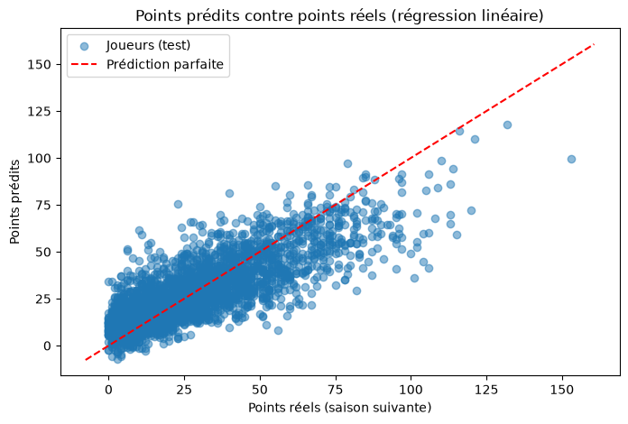

# Prédiction des points d'un joueur de la LNH

Projet 2 d'INF1007 (Polytechnique Montréal, A2026), réalisé par Loïc Rousseau et Jade Karaoulanis.

## Description

Application avec interface graphique qui estime combien de points un joueur de la LNH fera la saison suivante, à partir de ses statistiques de la saison courante.

## Jeu de données

- **Nom** : NHL Statistics, fichier `skaters_by_season_summary.csv`
- **Auteur** : natashk (Kaggle)
- **Lien** : https://www.kaggle.com/datasets/natashk/nhl-statistics
- **Date de consultation** : 2026-10-27
- **Licence** : « Other (specified in description) » 
- **Contenu** : statistiques de saison régulière des patineurs de la LNH, une ligne par joueur et par saison (47 644 lignes et 26 colonnes au départ). Les statistiques sont triées par ordre alphabétique du nom de famille des jouerus selon l'année de la saison (1937 à 2026).

## Étape 1 : exploration et nettoyage (`src/donnees.py`)

### Exploration

Utilisitation de l'outil **pandas** afin de lire, netttoyer et analyser le fichier .csv contenant les statistiques des joueurs de la LNH.

Observations principales :
- `timeOnIcePerGame` est absente pour les saisons avant **1997-1998**.
- Certaines catégories sont superflues, car certaines statistiques se retrouve facilement à l'aide de d'autres colonnes

### Nettoyage et transformations

| Opération | Justification |
|---|---|
| Garder les saisons à partir de 1997-1998 | Première saison où `timeOnIcePerGame` est disponible pour tous les joueurs |
| Retirer les colonnes inutiles (équipes, décompositions en avantage numérique, etc.) | Non pertinentes ou redondantes pour la prédiction |
| Garder `playerId`, `seasonId`, `skaterFullName` sans les utiliser comme entrées | Construction de la cible, séparation par joueur et recherche dans l'interface |
| Construire la cible `points_suivante` | Points du même joueur à la saison suivante |
| Garder seulement les saisons consécutives | Évite d'associer deux saisons éloignées (le lock-out de 2004-2005 est donc exclu) ou les saisons avec blessures |

Résultat : **18 973 lignes** après nettoyage et construction de la cible.

### Caractéristiques retenues

- **Numériques** : nombre de matchs joués : `gamesPlayed`, nombre de buts : `goals`, nombre de mentions d'aide : `assists`, nombre de tirs au but : `shots`, nombre de minutes de pénalité : `penaltyMinutes`, différentiel de la saison : `plusMinus`, temps moyen passé sur la glace par match (en secondes) : `timeOnIcePerGame`
- **Catégorielle** : position du joueur : `positionCode`
- **Cible** : `points_suivante` (régression)

## Étape 2 (entrainement)

Lors de l'entrainement, le modèle a obtenu une précision de 61% lorsqu'il a prédit les résultats avecune marge de +/- 8 points. On peut aussi le constater dans le graphique de corélation suivant (Graphiques/predit_reel.png). 
La RMSE est d'environ 13, donc on a une marge d'erreur de +/- 13 en moyenne sur les points prédits. De plus, comme le hockey est un sport complexe et imprévisible, il est compliqué de prédire à la perfection les sattistiques d'un joueur, car il y a beaucoup d'imprévisibilité.

Voici un graphique représentant le nuage de points des prédictions.

## Étape 3 (interface)

### Technologie
 
**Tkinter** (avec `ttk` pour le style), inclus avec Python et fonctionnant en local. Les graphiques Matplotlib sont intégrés dans la fenêtre avec `FigureCanvasTkAgg`. Le choix et la maquette papier ont été présentés à l'auxiliaire (validation D).
 
### Les écrans
 
Notre maquette comporte un menu et quatre écrans. Chaque écran est une classe enfant de `Ecran`.
 
| Écran | Ce que fait l'utilisateur |
|---|---|
| **Menu** | Choisit l'une des fonctions de l'application. |
| **Prédire à partir d'un joueur réel** | Filtre par équipe, tape quelques lettres du nom (liste filtrée en direct), choisit un joueur. La prédiction utilise sa dernière saison. |
| **Prédire à partir de statistiques** | Remplit un champ par variable : un champ numérique pour une statistique, une liste déroulante pour la position. Les points et les points en avantage numérique sont calculés à partir des buts, des aides et des points à forces égales. |
| **Graphiques** | Choisit une statistique (par exemple le temps de glace moyen) et voit son histogramme, avec un titre et des axes étiquetés. |
| **Historique** | Consulte les prédictions faites, enregistrées dans un fichier CSV. |

---
 
## Documentation consultée
 
- pandas, *10 minutes to pandas* : https://pandas.pydata.org/docs/user_guide/10min.html
- pandas, `DataFrame.groupby` : https://pandas.pydata.org/docs/reference/api/pandas.DataFrame.groupby.html
- scikit-learn, `LinearRegression` : https://scikit-learn.org/stable/modules/generated/sklearn.linear_model.LinearRegression.html
- scikit-learn, `train_test_split` : https://scikit-learn.org/stable/modules/generated/sklearn.model_selection.train_test_split.html
- Python, module `tkinter` : https://docs.python.org/3/library/tkinter.html
- Matplotlib, intégration dans Tkinter : https://matplotlib.org/stable/gallery/user_interfaces/embedding_in_tk_sgskip.html
- GitHub Actions, Python : https://docs.github.com/actions/automating-builds-and-tests/building-and-testing-python
---
